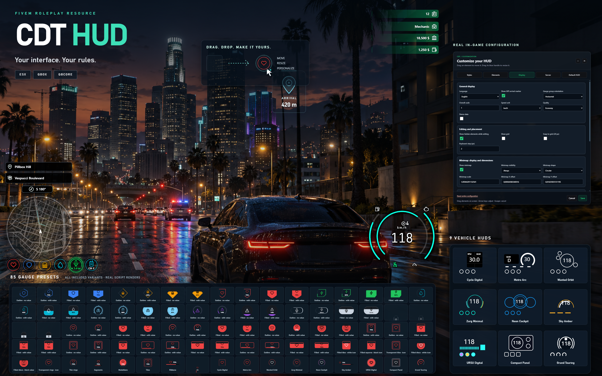

# cdt_hud



## Join the CDT community

Need help installing or configuring the HUD? **Join our Discord for support**, meet the community and explore our development work. Follow what we are building and share your feedback.

[](https://discord.gg/yNkYVhNCQQ)

**[Get support →](https://discord.gg/yNkYVhNCQQ)** · **[Follow our development →](https://discord.gg/yNkYVhNCQQ)**

## License

The [CDT HUD Personal Use and No-Resale License](LICENSE) allows personal use, source-code modification and free redistribution with attribution and the same terms. Selling the resource, modified copies or paid bundles containing its code is prohibited without CDT's prior written authorization. Third-party assets retain their own licenses; see [attribution](docs/ATTRIBUTION.md).

[Français](README.fr.md) · [Developer guide](docs/DEVELOPMENT.md) · [Client API](docs/API.md) · [Changelog](CHANGELOG.md)

Configurable FiveM HUD for ESX, Qbox, QBCore and standalone native indicators. Includes player and vehicle gauges, voice/radio, square or round minimap, styles, SQL profiles, seatbelt, cruise control, indicators, cinema mode and a GPS arrival overlay. Plain HTML/CSS/JavaScript; no frontend build required.

## Installation

1. Keep the resource folder named `cdt_hud`.
2. Install and configure `oxmysql`. Start your framework and data providers first.
3. Add the following to `server.cfg`:

```cfg
set cdt_language "en"
ensure oxmysql
# Start your framework and providers here.
ensure cdt_hud
```

Edit `config.lua` and `config/integrations.lua`. Use `Framework = 'auto'` or select a framework explicitly. Auto detection prefers Qbox, QBCore, then ESX. Without a detected framework, native indicators remain available.

SQL tables are created automatically. Player preferences are stored by license identifier and shared across characters. Existing SQL/KVP settings are migrated by the resource. Back up the database before updating an existing installation.

## Player controls

| Control | Default |
|---|---|
| Open configuration | `/hud` or F7 |
| Cinema mode | O or `/hudcinema` |
| Seatbelt | B or `/hudbelt` |
| Cruise control | Left Shift or `/hudcruise` |
| Indicators / hazards | Left / Right / Down arrows |

FiveM key bindings can override these defaults. In the editor, choose a style or element, adjust appearance and position, then **Save**. **Cancel** restores the previous profile. Display settings include language, speed units, minimap and the optional GPS arrival marker.

`cdt_language` supplies the initial language for new profiles. Missing or unavailable language: English. Players can save a different language in their HUD settings; their personal choice takes priority. Shipped translations: French and English.

The GPS overlay is enabled by default and appears only for the driver, within 700 units of their personal waypoint and in the camera's viewing direction. When terrain height is unavailable, a temporary label appears near the top of the view. Once terrain is known, it transitions to the world anchor in 350 ms. Height is 40 units beyond 100 m, dropping faster to 10 units at 30 m. A diffuse world-space ray points to the ground with a gap below the label. It disappears with the waypoint. `Config.Destination` controls global availability, radius and far height.

Seatbelt and optional collision ejection apply to compatible road vehicles. Cruise control starts above 20 km/h and releases on braking, engine stop, driver or vehicle change. Disable overlapping modules when another resource manages these mechanics.

## Administration

```cfg
add_ace group.admin cdt.hud.configure allow
# Add this only if your owner group does not already inherit admin permissions:
add_ace group.owner cdt.hud.configure allow
```

Assign players to the appropriate principals using your server's permission setup. Server configuration and default-profile publishing require this ACE, configurable through `Config.AdminAce`. Published defaults apply to players without a personal profile. Existing players retain their settings; a full reset uses the current server default.

- `/huddiagnostic`: framework and provider diagnostics in F8.
- `/hudpermissions`: effective permission diagnostics.
- `hudbridgereset`: restore integration file defaults (server console or authorized administrator).
- `Config.Debug = true`: enable the JSON debug tab and extra diagnostics. Disabled in the release configuration.

## Troubleshooting and updates

No HUD: check character loading, pause/cinema state and external visibility requests. Missing data: check provider selection and installed API compatibility. Editor unavailable: check SQL startup and F8/server logs. Duplicate gauges or vehicle controls: disable overlapping resources/modules.

Restart `cdt_hud` after changing configuration files or `cdt_language`. The browser UI needs no compilation. Performance budgets and full ESX/Qbox/QBCore gameplay compatibility require validation on your own server; automated tests do not certify GTA native rendering or third-party provider versions.

See the [developer guide](docs/DEVELOPMENT.md), [API](docs/API.md), [French documentation](README.fr.md) and [asset attribution](docs/ATTRIBUTION.md).
